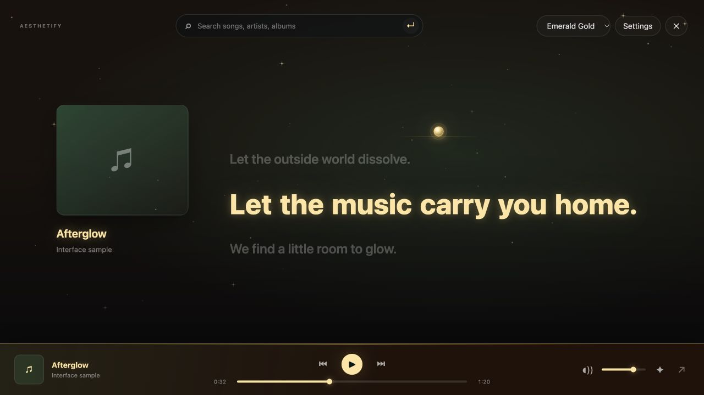

# Aesthetify

**Your music. Your atmosphere.**

An independent Chrome extension that adds an immersive lyric stage, seven animated palettes, and a matching player dock to Spotify Web.



**Status: public beta.** Core logic is tested and the interface is checked with local fixtures. Full production compatibility across Spotify accounts, locales, and site updates has not been established. Aesthetify is not published in the Chrome Web Store or endorsed by Spotify.

## Features

- Bold lyric lines with spaced word-pop transitions, driven by Spotify's visible active line.
- Instrumental visuals when a clear lyric line is absent or an instrumental marker is shown.
- Emerald Gold shooting stars, Rose Quartz petals, Midnight Rain window droplets, Solar Fire flames, Violet Dream twinkles, Ocean Glow waves, and Golden Hour glints.
- Automatic palette changes and visual layouts on a 10-second timeline, plus per-track palette overrides.
- A persistent matching player dock with play/pause, skip, seek, volume, and a fallback to Spotify's original player.
- Search through Spotify's native search interface.
- Local preferences and optional timed-lyric imports.
- Reduced-motion support.

**No audio capture, microphone access, recording, audio analysis, or audio-output rerouting.** The small glow above the lyrics is decorative.

## Install locally

1. Download and extract the extension ZIP from this repository's Releases, or clone this repository.
2. In Chrome, open `chrome://extensions` and enable **Developer mode**.
3. Choose **Load unpacked** and select `extension/` in a clone, or the extracted release folder containing `manifest.json`.
4. Refresh Spotify Web, select a song, and play it.

Remove or disable previous Neon/Aesthetify copies. Install only one copy at a time. This package does not auto-update through Chrome Web Store.

Press Escape to leave immersive view. The arrow on the custom dock reveals Spotify's native controls. The extension toolbar popup also offers native-player fallback. Settings contains automatic opening, rain droplets, and optional personal lyrics.

## Limitations

- Word pops are an animation of a Spotify-highlighted line, not measured vocal word timings. Explicit word timings require a matching imported file.
- Spotify's DOM is the compatibility adapter. Site updates, unavailable lyrics, account restrictions, or different markup can stop automatic detection.
- An old line may remain visible if Spotify leaves it highlighted throughout an instrumental break. Aesthetify does not infer vocals from audio.
- The custom player forwards actions to visible Spotify controls. It cannot initialize an unavailable Spotify playback device; unsupported controls are disabled.
- Search tries Spotify's own search input. Its normal-URL fallback can reload the page and interrupt playback.

If Spotify fails, use the native-player fallback, disable Aesthetify, and test Spotify alone. Please report whether the problem remains without the extension. Do not post account credentials or private logs.

## Development

Node.js 22 or newer. There are no npm dependencies and no build step is required to load `extension/`.

```sh
npm run check
npm test
npm run build
```

`build` creates `dist/Aesthetify-1.0.0.zip`, with `manifest.json` at its root. Only extension runtime assets and its user documentation enter the install ZIP. Tests, screenshots, and contributor documents stay in the source repository.

See [CONTRIBUTING.md](CONTRIBUTING.md) for the project structure and verification workflow.

## Privacy and permissions

See [PRIVACY.md](PRIVACY.md). Preferences and optional imported lyrics stay in extension-local storage. No analytics or extension backend is included. Content scripts run only on `open.spotify.com`; `activeTab` identifies the Spotify tab when the toolbar popup is invoked.

## Distribution and rights

The MIT license covers this repository's original code and original icons. It does not grant rights to Spotify's trademarks, artwork, songs, lyrics, or third-party content. This repository contains no Spotify songs, fetched lyric catalog, or album artwork; its screenshot uses original sample text and a placeholder cover.

Before distributing or submitting this extension publicly, assess applicable Spotify policies, lyric rights, and Chrome Web Store requirements. Spotify's developer policy restricts synchronization with visual media; applicability and any required permissions must be resolved rather than assumed. See the [Spotify Developer Policy](https://developer.spotify.com/policy) and [Chrome Web Store policies](https://developer.chrome.com/docs/webstore/program-policies/).

## License

[MIT](LICENSE). Copyright 2026 Aesthetify contributors.
